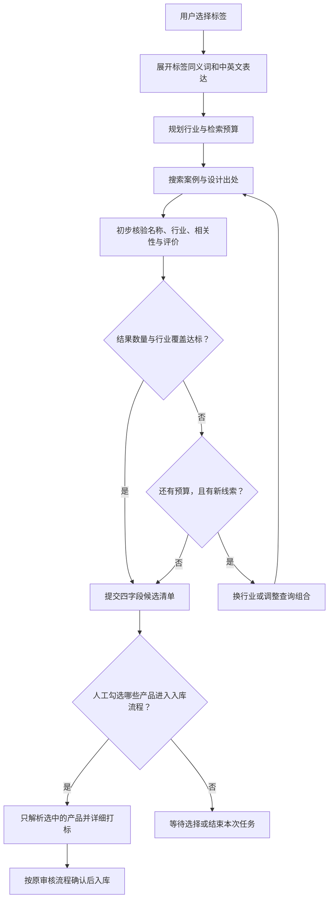

# 跨行业设计案例检索 Skill 流程

用户在已解析产品的网页上选中标签后，启动一次有明确预算的外部检索。检索结束先发候选清单，等用户勾选后再整理完整信息和标签。

## 1. 从标签生成查询

- 网页传入所选标签的 ID、名称、所属类别，以及原产品的 ID 和行业。原产品用来排除自身、识别同行业和提供对照。
- 单标签直接搜索该特征。多标签优先搜索共同命中，长标签组合可先搜索两个区分度最高的标签，再对候选逐个核验其余标签。初筛时确认候选与所选标签的相关性，完整标签记录在人工选中后生成。
- 每个标签由词表或模型补充中英文同义词、常见外观表达和可观察的判断条件。例：「规整接缝」可展开为“缝隙均匀”“even panel gaps”。「工业感」可结合构件外露、重复分舱等可观察线索，保留主观判断依据。
- 根据标签挑选可能有相似设计手法的行业。例：「横向延展」与「重复分舱」可尝试交通设备、家电和模块化家具。行业词用于分配搜索方向，标签仍决定案例是否相关。

## 2. 每次检索的上限

以下是第一版默认值，以单次用户操作为单位。

| 项目 | 默认值 |
|---|---|
| 行业方向 | 最多 4 个，优先包含至少 3 个原行业以外的方向，按可能性分配 |
| 查询 | 最多 8 条。首轮至多 4 条，补搜一轮至多 4 条 |
| 候选核验 | 最多 24 个去重后的候选 |
| 返回 | 最多 6 个，单一行业最多 2 个。先取完整命中 |
| 提前停止 | 已有 6 个合格案例，覆盖至少 3 个行业，其中至少 2 个为原行业以外；或最近连续 2 条查询无新增合格案例且已覆盖计划中的首轮方向 |
| 硬停止 | 查询、核验或 90 秒预算任一达到即结束；到时取消尚未完成的请求，返回已核验结果 |

补搜优先查覆盖不足的行业或替换同义词。同一候选按品牌、型号和变体去重，多篇报道只增加证据。没有足够的完整命中时，可展示少量部分匹配，并列清缺少哪些标签。最多返回 6 个的上限对两类结果合计生效。更广范围由用户主动开启新一轮，每轮独立计量。

## 3. 定义怎样的案例值得返回

候选需能确认具体产品和设计特征，并有可追溯的设计价值证据。

| 核验项 | 可接受的证据 |
|---|---|
| 产品身份 | 品牌官网、制造商资料或设计机构项目页能够确认产品名及型号或版本 |
| 标签匹配 | 产品图或规格支持具体特征。推断型标签需写清观察依据与不确定性 |
| 设计价值 | 设计奖官方名单、博物馆或专业机构选录、可信设计媒体对该产品的专题评述。记录实际来源与入选或评述理由 |

先按标签相关性、证据质量和行业覆盖排序。将搜索用量和停止原因保留在检索记录中。

## 4. 人工初筛

每个候选只展示以下四列。

| 产品名称 | 所属行业 | 业界评价（浓缩） | 网页链接 |
|---|---|---|---|
| 官网或设计方使用的名称，必要时带型号 | 用于快速判断跨行业参考价值 | 用一句话概括获得的认可或专业评述，写明评价方与具体亮点 | 产品官网或项目页，可附评价原文链接 |

检索阶段只做支撑初筛的最低限度核验。无法查证的评价不写成行业共识。提交候选清单后暂停，等待用户勾选。

## 5. 选中后解析和入库

把用户选中的候选、原查询标签和来源链接交给 Product Research Skill，补全基础信息、图片、其余设计标签和证据，再按既有审核流程入库。初筛未选中的候选停留在候选清单中。